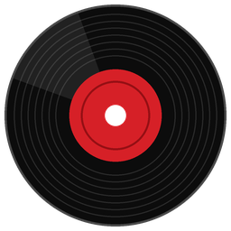
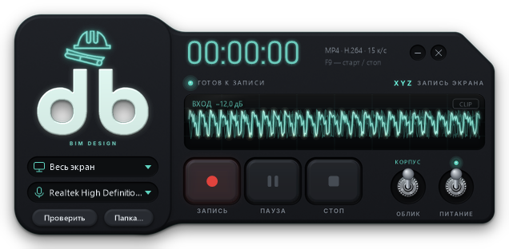
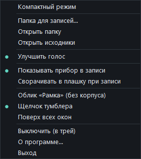
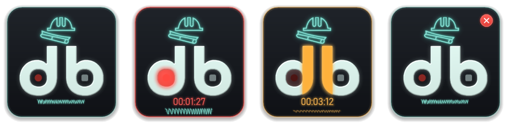
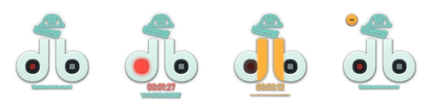
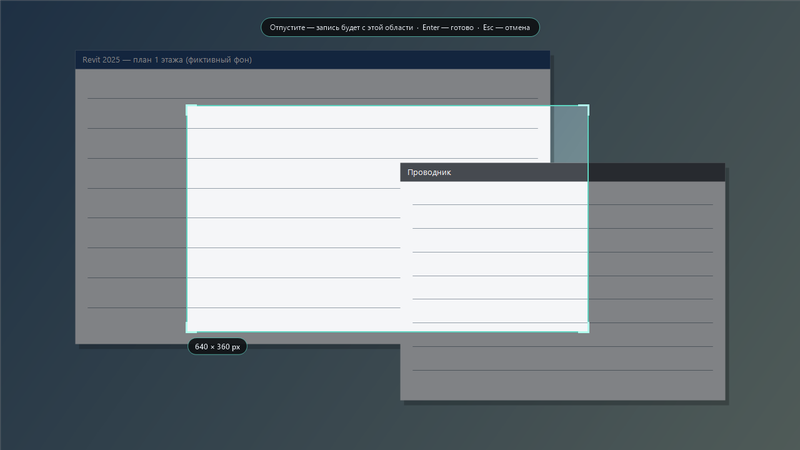
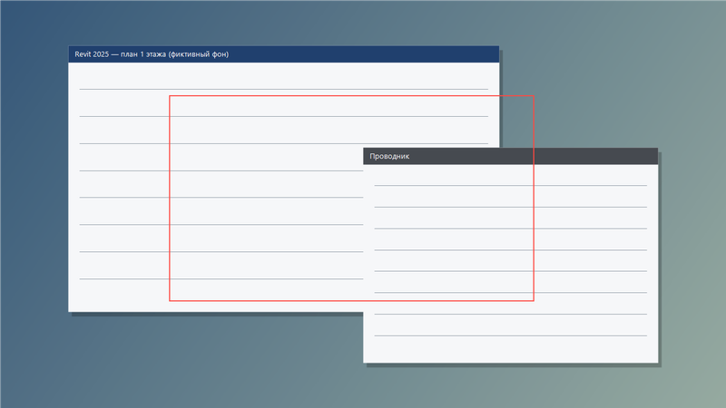
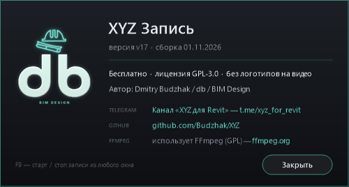

<p align="center">
  
</p>

<h1 align="center">XYZ Запись</h1>

<p align="center">
  Запись экрана со звуком для проектировщиков — «прибор» в стиле плагина XYZ.<br>
  Версия 18 · Windows 10/11 · бесплатно, без логотипов на видео · GPL-3.0
</p>

---

## Что это

**XYZ Запись** — маленькая программа, чтобы быстро записать экран вместе с голосом: показать замечания по модели, объяснить узел коллеге, снять короткую инструкцию. Пишет весь рабочий стол, один монитор, окно или выбранную мышью область в обычный MP4 (H.264 + AAC), который открывается где угодно и отправляется в любой мессенджер.

- одна кнопка или **F9** — и запись пошла;
- пауза, таймер и «осциллограф» голоса прямо на приборе;
- сам прибор в видео не попадает;
- **«Улучшить голос»** — убирает шум и гул, выравнивает громкость;
- компактный режим — только эмблема **db** с кнопками в буквах;
- без установки: запускается прямо из папки.



> **Гифки режимов — скоро.** Здесь появятся живые записи: программа отдельно, на фоне рабочего стола, и запуск из Revit.

## Скачать и запустить

1. Возьмите портабельный архив `XYZ-Record_portable_*.zip` (или папку `bin/` из репозитория) и распакуйте в любое место — на диск, рабочий стол, Яндекс.Диск. Папку держите целиком, вместе с подпапкой `ffmpeg`.
2. Запустите **`XYZ Запись.exe`**. Устанавливать ничего не нужно.
3. Если появится синее окно SmartScreen «Система Windows защитила ваш компьютер», нажмите **«Подробнее» → «Выполнить в любом случае»**. Программа не подписана цифровой подписью, поэтому Windows так реагирует на первый запуск на новом компьютере.
4. Если в записи нет звука — откройте **Параметры Windows → Конфиденциальность и защита → Микрофон** и включите «Доступ к микрофону» и «Разрешить классическим приложениям доступ к микрофону».

Удобно сделать ярлык: правой кнопкой по `XYZ Запись.exe` → «Отправить» → «Рабочий стол (создать ярлык)».

Программа однокопийная: повторный запуск не открывает вторую копию, а показывает уже запущенный прибор.

## Режимы

### Полный прибор

Слева — эмблема и выбор источника (экран, монитор, окно, область) и микрофона. Справа — таймер, осциллограф и пэды **«Запись» / «Пауза» / «Стоп»**, тумблеры **«Облик»** и **«Питание»**.

| Что | Как |
|---|---|
| Начать / остановить запись | пэд «Запись» / «Стоп» или клавиша **F9** из любого окна |
| Пауза | янтарный пэд «Пауза» |
| Облик | тумблер «Облик»: вверх — **«Корпус»**, вниз — **«Рамка»** (корпус исчезает, остаётся светящийся контур) |
| Питание | тумблер «Питание» прячет прибор в трей; вернуть — щелчок по значку у часов |
| Перетаскивание | за корпус (в облике «Рамка» — за контур и элементы) |
| Меню | правая кнопка мыши по прибору |

<p align="center"></p>

### Компактный режим

Двойной щелчок по эмблеме (или пункт меню «Компактный режим») — и от прибора остаётся только эмблема **db**. Кнопки спрятаны прямо в буквах:

| Кнопка | Где |
|---|---|
| **Запись** | красная точка в кружке буквы **«d»** |
| **Пауза** | две вертикальные палочки **«d»** и **«b»** (вместе — знак ‖), на паузе горят янтарным |
| **Стоп** | светлый квадратик в кружке буквы **«b»** |
| **Свернуть / Закрыть** | подведите курсор к левому или правому верхнему углу — плавно появятся кнопки **«–»** (в трей) и **«×»** |

Во время записи вместо надписи «BIM DESIGN» идёт таймер, а под ним — мини-осциллограф: бирюзовые волны голоса (на паузе — янтарные, в тишине — ровная линия). Режим запоминается, **F9** работает как обычно, перетаскивать — за любое место вне кнопок.

Облик «Корпус» — эмблема на плашке:



Облик «Рамка» — **без плашки**: на прозрачном фоне только каска, буквы, таймер и волна с мягкой тенью, щелчок мимо эмблемы уходит в окно под ней:



### Плашка при записи

Пункт меню «Сворачивать в плашку при записи»: как только запись началась, полный прибор сам сворачивается в компактную эмблему с таймером и волной и не загораживает экран.

## Выбор области

Список источника → **«Выбрать область…»**: экран затемняется, тяните рамку мышью — рядом виден размер в пикселях. Отпустили кнопку (или **Enter**) — область выбрана; **Esc** или правая кнопка — отмена. Последняя область запоминается и появляется в списке.

<p align="center">
  
  
</p>

Во время записи вокруг области горит тонкая красная рамка (на паузе — янтарная). Она снаружи области и в видео не попадает.

## Настройки в меню

- **«Улучшить голос»** — после остановки программа делает второй проход по звуку: убирает гул и шум, выравнивает громкость, смягчает шипящие. Видео при этом не перекодируется.
- **«Показывать прибор в записи»** — по умолчанию прибор, плашка и рамка области в видео не попадают; включите, если хотите, чтобы зритель видел прибор.
- **«Поверх всех окон»**, выбор микрофона, «Обновить список» (если микрофон подключили после запуска).

## Куда сохраняются записи

- По умолчанию — на **Рабочий стол**, файлы вида `zamechaniya_2026-11-02_1030.mp4`. Другую папку — «Папка для записей…», открыть её — «Открыть папку».
- Если включено «Улучшить голос», исходная запись без обработки кладётся в `%LOCALAPPDATA%\XYZ\raw` и хранится 7 дней (старые удаляются при запуске). Открыть — «Открыть исходники».
- Настройки — `%APPDATA%\XYZ\recorder.ini`, на каждом компьютере свои.

## О программе

Пункт меню **«О программе…»**: версия и дата сборки, лицензия, автор и ссылки — Telegram-канал [«XYZ для Revit»](https://t.me/xyz_for_revit), [GitHub](https://github.com/Budzhak/XYZ), [ffmpeg.org](https://ffmpeg.org).

<p align="center"></p>

## Требования

- Windows 10 версии 2004 (май 2020) или новее, либо Windows 11, 64-разрядная. На более старых Windows 10 прибор не скрывается из записи.
- .NET Framework 4.x — уже есть в Windows 10/11.
- Микрофон — для записи голоса.

Запись выполняет **FFmpeg** из подпапки `ffmpeg\`. Если его там нет, программа ищет `ffmpeg.exe` рядом с собой, в папке Shotcut и в PATH, а при неудаче пишет на приборе «Не найден ffmpeg».

## Сборка из исходников

Исходник — `src/RecorderDevice.cs` (C#, WinForms, один файл), графика — `src/res/*.png`. Сборка встроенным компилятором .NET Framework, Visual Studio не нужна:

```
src\build.cmd
```

Готовая портабельная папка — `bin/`.

## Лицензии

**XYZ Запись** — GPL-3.0, см. [LICENSE](LICENSE). Автор — Dmitry Budzhak (db) / BIM Design.

Программа использует [FFmpeg](https://ffmpeg.org) (GPL); сторонние компоненты и их лицензии — в [THIRD_PARTY.md](THIRD_PARTY.md).
